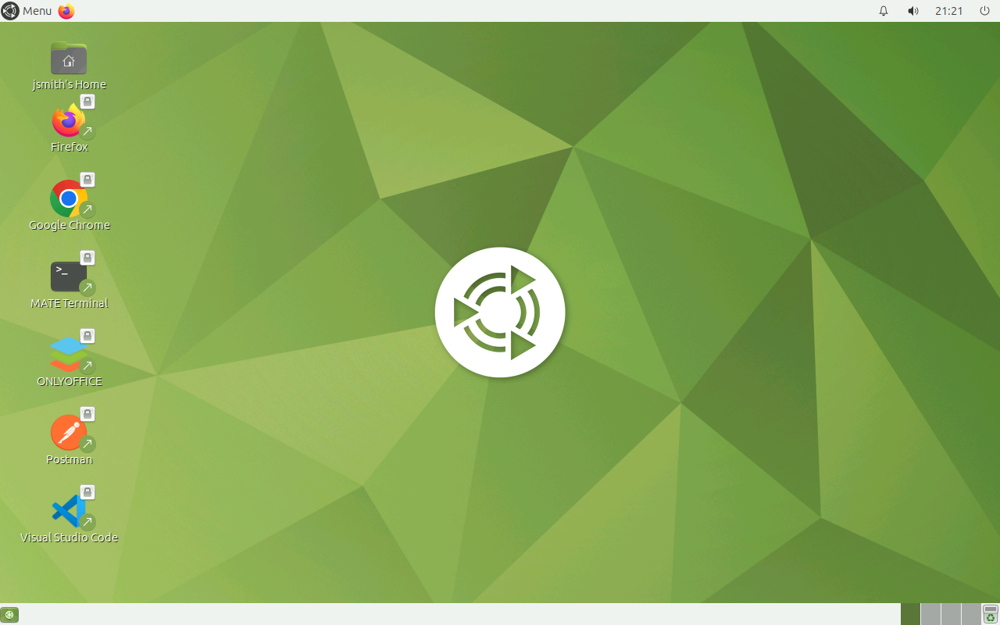
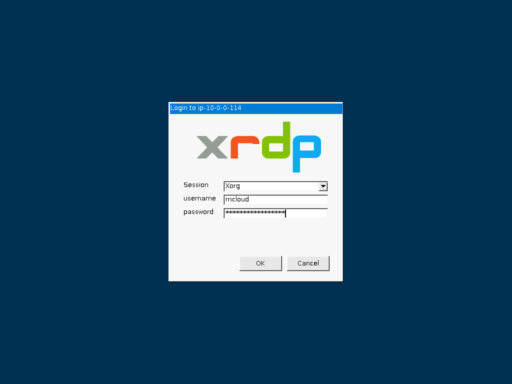

# MATE XRDP Desktop + Active Directory on Azure

A cloud Linux workstation for every build on the channel. A **MATE** desktop
on **Ubuntu 26.04 LTS**, reached over RDP (XRDP), joined to a **mini-AD**
domain, with home directories on **Azure Files (NFS)**. Users sign in with
their AD account, and their files follow them to any desktop built from the
same image.



| Piece | Where | Role |
|---|---|---|
| **MATE desktop** | `vm-subnet` | Packer-built managed image (MATE + XRDP + dev tools); joined to AD with SSSD at boot; RDP and SSH from the internet |
| **Windows Server 2022** | `vm-subnet` | joined to AD; RSAT for managing users; maps the desktop's `/nfs` share as `Z:` |
| **mini-AD** (Samba DC) | `mini-ad-subnet` | users, groups, POSIX IDs, DNS, Kerberos |
| **Azure Files** (Premium, NFS 4.1) | private endpoint in `vm-subnet` | `/home` and the shared `/nfs` area; public network access disabled |
| **Key Vault** | `mate-network-rg` | AD admin and user passwords, read by the VMs' managed identities |
| **Blob Storage** | `mate-project-rg` | the Windows host's domain-join script |
| **NAT gateway** | both subnets | outbound internet for the DC |

## Architecture

<picture>
  <source media="(prefers-color-scheme: dark)" srcset="architecture-dark.svg">
  
</picture>

Regenerate with `python3 make_diagram.py`.

- **`01-directory/`**: the `mate-network-rg` resource group, the VNet
  (`ad-vnet`, 10.0.0.0/23) with `vm-subnet` and `mini-ad-subnet`, the NSG and
  NAT gateway, Key Vault with the generated passwords, and the
  [`module-azure-mini-ad`](https://github.com/mamonaco1973/module-azure-mini-ad)
  Samba DC with users and POSIX attributes from `users.json`. The VNet's DNS
  points at the DC. Azure Bastion is optional (`bastion_support`, off by
  default).
- **`02-packer/`**: builds the MATE managed image in `mate-project-rg`
  from Canonical's Ubuntu 26.04 image: `ubuntu-mate-desktop`, XRDP with a MATE session,
  the SSSD, realmd and Samba packages, `aznfs`, and the
  channel's tool set (Chrome, Firefox, VS Code, Docker, Packer, Terraform,
  AWS/Azure/Google Cloud CLIs, Postman, KRDC, OnlyOffice). The domain join is
  left to boot time, because a computer account and keytab can't be baked
  into a shared image.
- **`03-servers/`**: the Azure Files account and NFS share with its private
  endpoint and DNS zone, the MATE desktop and Windows VMs with their
  managed identities, and the blob that holds the Windows join script.

## What's in the image

- **Snap is left as Ubuntu ships it.** Firefox is a snap. Chrome, VS Code,
  Postman and OnlyOffice come from `.deb` packages.
- **Snaps work in an XRDP session** because `/etc/xrdp/startwm.sh` exports
  `XAUTHORITY`. XRDP starts Xorg with `-auth .Xauthority` but doesn't export
  the variable; snaps run with a redirected `$HOME`, so without it they fail
  with "Authorization required".
- **No polkit prompts in RDP sessions.** A polkit rule allows colour-profile
  and package-refresh actions that otherwise ask for a password at login.
- **No NetworkManager.** The desktop packages pull it in, and on Azure it
  fights cloud-init for the NIC, so the VM can lose its network after a
  reboot. The build removes it, pins it out of apt and masks its services.
- **`aznfs` mounts Azure Files.** It comes from Microsoft's Ubuntu 26.04
  repository, signed with Microsoft's 2025 key.
- **New users get the desktop icons and defaults** from `/etc/skel`.

## How sign-in works

1. At boot the desktop waits for the Azure Files private endpoint to resolve,
   mounts `/nfs` (and `/home` from `/nfs/home`), reads the AD admin password
   from Key Vault with its managed identity, and joins the domain with
   `realm join`, retrying while the DC settles. SSSD is set for short names
   (`jsmith`, not `jsmith@mcloud.mikecloud.com`) and the POSIX IDs stored in
   AD.
2. An RDP client connects to the desktop's public DNS name on 3389. XRDP
   checks the password through PAM and SSSD, creates the home directory on
   Azure Files on first login, and starts MATE.
3. Members of **`linux-admins`** (jsmith and rpatel) get passwordless sudo.
4. The Windows host downloads `ad-join.ps1` from Blob Storage through the
   Custom Script Extension, joins the same domain, lets `mcloud-users` sign in
   over RDP, and maps the desktop's Samba share of `/nfs` as `Z:`, which holds
   this repository and the helper scripts.

| User | Groups | sudo on the desktop |
|---|---|---|
| jsmith | mcloud-users, us, linux-admins | yes |
| edavis | mcloud-users, us | no |
| rpatel | mcloud-users, india, linux-admins | yes |
| akumar | mcloud-users, india | no |

## Network security

```
internet ─3389, 22, 445─▶ MATE desktop ─2049─▶ Azure Files (private endpoint)
internet ─3389─────────▶ Windows ─445─▶ MATE desktop (Z: is /nfs)
```

`vm-nsg` on `vm-subnet` allows 3389, 22 and 445 from anywhere; every login
still needs an AD account. The DC and the storage account have no public
endpoint.

## Prerequisites

* [An Azure Account](https://portal.azure.com/)
* [Install AZ CLI](https://learn.microsoft.com/en-us/cli/azure/install-azure-cli)
* [Install Terraform](https://developer.hashicorp.com/terraform/install)
* [Install Packer](https://developer.hashicorp.com/packer/install)
* [Install jq](https://jqlang.github.io/jq/download/)

`check_env.sh` expects a service principal in `ARM_CLIENT_ID`,
`ARM_CLIENT_SECRET`, `ARM_SUBSCRIPTION_ID` and `ARM_TENANT_ID`. If this is
your first time watching our content, we recommend starting with this video:
[Azure + Terraform: Easy Setup](https://www.youtube.com/watch?v=j4aRjgH5H8Q).

Everything deploys to Central US. The desktop VM and the Packer builder are
`Standard_D4s_v3` (4 vCPUs each), so with the default 10-vCPU DSv3 quota,
build one of these labs at a time.

## Deploy

```bash
git clone https://github.com/mamonaco1973/azure-mate-xrdp.git
cd azure-mate-xrdp
./apply.sh       # 1: VNet, Key Vault, mini-AD  2: MATE image (Packer)  3: Azure Files, desktop, Windows
```

A full run takes 30 to 35 minutes: phase 1 about 6 (3 of them waiting for
the DC), the Packer build 13 to 21, and phase 3 about 10, most of it the
Windows host's join script. Each run of `apply.sh` builds a fresh image, and
phase 3 always uses the newest one. After phase 3, the desktop needs about
**5 minutes** to mount Azure Files and join the domain, and the Windows host
about **10 minutes** to join and reboot.

`apply.sh` ends by running `validate.sh`, which prints the two hosts and a
login:

```
============================================================================
MATE Quick Start - Validation Output (Azure)
============================================================================

NOTE: Resource Group:        mate-project-rg

NOTE: Windows RDP FQDN:      win-ad-a1b2c3.centralus.cloudapp.azure.com
NOTE: MATE Host:          mate-a1b2c3.centralus.cloudapp.azure.com

NOTE: Sign in:               jsmith / orange-481920
                             Desktop: jsmith. Windows: MCLOUD\jsmith.
                             Other users: <user>-credentials
                             in Key Vault ad-key-vault-k3m9x2pq.
```

## Try it

1. `validate.sh` prints jsmith's password. For another user, get it from
   Key Vault:

   ```bash
   vault=$(az keyvault list -g mate-network-rg \
     --query "[?starts_with(name, 'ad-key-vault')].name | [0]" -o tsv)
   az keyvault secret show --vault-name "$vault" --name edavis-credentials \
     --query value -o tsv | jq -r .password
   ```

2. RDP to the **MATE Host** as `jsmith`. The MATE desktop opens, and
   jsmith's home directory is created on Azure Files on first login. Try `id`,
   `getent group linux-admins`, `sudo -l` and `df -h /home`.
3. Sign out and sign in as `edavis`: the same desktop, no sudo.
4. RDP to the **Windows RDP FQDN** as `MCLOUD\jsmith`. **Active Directory
   Users and Computers** is installed, and `Z:` is the desktop's `/nfs`.

### Add a desktop user

1. On the Windows host, open **Active Directory Users and Computers** and turn
   on **View > Advanced Features**.
2. Under the **Users** container of `mcloud.mikecloud.com`, create the user
   (for example `mcloud`) and set a password.

   

3. Get the next free `uidNumber`: run `Z:\azure-mate-xrdp\04-utils\getNextUID.bat`.
4. In the user's **Attribute Editor**, set `uidNumber` to that value,
   `gidNumber` to `10001` (`mcloud-users`), and `uid` to the login name.
5. On **Member Of**, add `mcloud-users` (and `linux-admins` for sudo).
6. On the desktop (`ssh jsmith@<MATE Host>`), `id mcloud` shows the new
   IDs and groups.

   

7. RDP to the desktop as the new user.

   

## Troubleshooting

| Symptom | Fix |
|---|---|
| RDP rejects every AD password | The desktop hasn't finished its domain join. Read its boot log: `az vm run-command invoke -g mate-project-rg -n <vm> --command-id RunShellScript --scripts "tail -50 /root/boot.log"`. |
| The boot log ends in a `realm join` error | The join retries 10 times, 30 seconds apart. If all fail, check that the DC is running and that `ad-vnet` lists it as its DNS server. |
| `/nfs` is empty or `/home` is missing | `findmnt /nfs` on the desktop. The mount needs the private endpoint's DNS name (`nfs<suffix>.file.core.windows.net`) to resolve to a 10.0.0.x address. |
| RDP connects, then closes | Check `/var/log/xrdp-sesman.log` and `~/.xsession-errors` on the desktop. The session runs `/etc/xrdp/startwm.sh`, which starts MATE. |
| Firefox takes a while to open the first time | Expected on a fresh VM: the snap sets itself up on first use. Later launches are quick. |
| A snap app won't open its window | `echo $XAUTHORITY` in the session should print an absolute path. If not, `/etc/xrdp/startwm.sh` is missing the export. |
| `id <user>` finds nothing | The user needs `uidNumber`, `gidNumber` and `uid` set in AD. SSSD caches lookups; `sudo sss_cache -E` clears it. |
| `Z:` is missing on Windows | The Windows host joins the domain and reboots after deploy; give it about 10 minutes. |
| Packer or phase 3 fails with a quota error | Another lab is using the region's DSv3 vCPUs. Destroy it, or raise the quota. |

## Teardown

```bash
./destroy.sh     # destroys phase 3, deletes the images, destroys phase 1 (Key Vault is purged)
```

## Notes

- **Lab only.** RDP, SSH and SMB are open to the internet, and the join uses
  the domain admin account. Restrict `vm-nsg` and use a dedicated join
  account for anything more.
- Users, groups and POSIX IDs are defined in
  `01-directory/scripts/users.json.template`.
